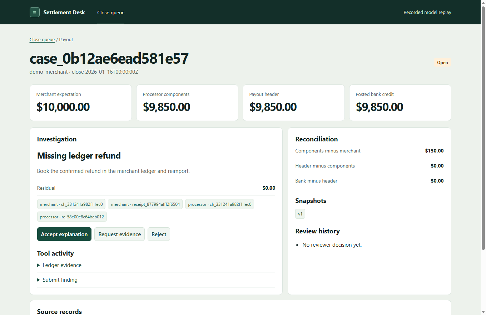

# Settlement Desk

Settlement Desk investigates payout discrepancies across a merchant ledger, processor settlement and bank statement. It verifies model findings against source records, keeps ambiguous deposits open, and records reviewer decisions across corrected imports.

[Four-minute walkthrough](assets/settlement-desk-walkthrough.mp4) · [Case study](docs/case-study.md) · [Structured benchmark](results/benchmarks/benchmark-v2.json) · [Support-thread benchmark](results/benchmarks/support-benchmark.json) · [Import contract](docs/inputs.md)

**Payments knowledge** answers questions about payops procedures and fees from the policy version applicable to a workspace, market and date. It runs Qwen locally, links claims to policy passages, and computes combined fees from source rows in integer cents. [Knowledge RAG case study](docs/knowledge-rag.md) · [Benchmark receipt](results/benchmarks/knowledge-benchmark.json)



## Run the demo

Run from the project root with Python 3.11 or later.

```powershell
python run.py demo
```

Open [the close queue](http://127.0.0.1:8765). The demo runs locally from the bundled model recording. Use **Run investigation** on the payout with a $150 ledger variance. Follow a source link, accept the explanation and return to the queue. Open the payout with an unknown bank variance and request the missing bank trace.

In a second terminal, import the two corrected source bundles. Reload the close queue to see both cases reconcile. Each case links back to the earlier evidence and review decision.

```powershell
python run.py import artifacts/workbench/desk-sample-inputs/03-corrected-ledger/manifest.json artifacts/workbench/desk-sample-inputs/04-bank-trace/manifest.json
```

To repeat the original workflow, start the demo with a fresh `--db` path. To run deterministic rules on a demo, pass `--mode baseline`.

## Run live on the local GPU

```powershell
pwsh -File scripts/with-model.ps1 -Task demo-live
```

The Windows wrapper starts the pinned Ollama runtime and Qwen3 8B Q4_K_M checkpoint from the project cache. The first download is about 7 GB. Allow 15 GiB of workspace disk for the cache and extraction. The live demo uses its own database and prints the corrections paths. Close the terminal session with Ctrl+C to stop the demo and its project model service.

## Investigate a support thread

Two bank credits can share the same amount while the processor's structured trace is missing. An optional processor support thread may distinguish the credits through a correction, a reply referring to an earlier message, or a note describing another merchant. The local model extracts a candidate and checks the interpretation against the thread. The software checks the matching credit and retains exact source quotes. The finding stays open for a structured reference and analyst follow-up.

```powershell
pwsh -File scripts/with-model.ps1 -Task demo-support
pwsh -File scripts/with-model.ps1 -Task benchmark-support
python run.py support-fixtures
```

Run the commands separately. The first starts the support-case demo. In a fresh demo database, [case 1](http://127.0.0.1:8765/cases/1) shows an overnight posting and a cancelled recovery batch. Select **Run investigation** to see the quoted evidence and suggested trace. The benchmark scores both modes against independently specified trace and citation labels. The fixture command exports the importable source bundles.

## Ask the payments policy library

```powershell
pwsh -File scripts/with-model.ps1 -Task demo-rag
```

Open [Payments knowledge](http://127.0.0.1:8765/knowledge), select **Combined dispute fees** and submit. For Atlas Pay · US with policy effective on April 12, 2025 and known on May 3, 2025, the two cited fee rows add to **$22.56**. Change **Known on** to May 25, 2025 and submit again to see the retroactive correction and **$23.62**. Open either citation to inspect its exact passage, dates and document digest.


The knowledge demo adds the pinned 639 MB Qwen3 Embedding checkpoint to the local cache. `python run.py demo` also serves the same library with offline keyword search. To use your own versioned synthetic library, pass `-KnowledgeCorpus <path>` to the live wrapper or `--knowledge-corpus <path>` to `python run.py serve`. [JSONL import contract](docs/policy-library.md)

## Import other synthetic data

Use [the CSV and manifest contract](docs/inputs.md) to create one bundle per payout snapshot. Use a fresh local database for a new close.

```powershell
python run.py import some-folder/manifest.json --db artifacts/my-close.db
python run.py list --db artifacts/my-close.db
python run.py serve --db artifacts/my-close.db
```

`serve` uses the rules-only mode by default. When the pinned service is already running on port 11439, `serve --mode live` uses the model. The server binds to loopback and is designed for one analyst and synthetic data.

## Verify the release

```powershell
python run.py check
python -m unittest discover -s tests
pwsh -File scripts/with-model.ps1 -Task benchmark
pwsh -File scripts/with-model.ps1 -Task benchmark-support
pwsh -File scripts/with-model.ps1 -Task benchmark-rag
pwsh -File scripts/with-model.ps1 -Task release
python run.py package
```

The benchmark pairs each frozen input with a rules-only result and a live-model result. It resumes checkpoints when model, data and implementation digests match. The release command also probes the GPU, validates the benchmark receipts, and starts the demo from a clean temporary source copy. Packaging writes `artifacts/Settlement-Desk.zip` with the source, replay, walkthrough and release evidence. The pinned model runtime and raw local run receipts live under `.runtime/` and `artifacts/`.

The included walkthrough uses desktop and mobile Edge captures. To regenerate it, run `python run.py walkthrough` with Edge, Node.js 22 or later, and FFmpeg available. On Windows, the renderer can also use the SHA-256-pinned imageio-ffmpeg 0.6.0 wheel placed in `.runtime/ffmpeg-wheel.whl`. [Pinned Windows wheel](https://pypi.org/project/imageio-ffmpeg/0.6.0/#imageio_ffmpeg-0.6.0-py3-none-win_amd64.whl)

## Repository layout

- `settlement/` — reconciliation engine, AI integration, storage, and web UI.
- `evaluation/` — datasets, evaluators, synthetic cases, and benchmark runners.
- `scripts/` — model startup, demos, and release utilities.
- `config/` — pinned model configurations.
- `results/` — published benchmark reports and recorded demo responses.
- `assets/` — screenshots and walkthrough video.
- `docs/` — case studies, input specification, and [benchmark provenance](docs/benchmark-provenance.md).
- `tests/` — automated tests.

Published benchmark fingerprints refer to their historical source versions; see [provenance](docs/benchmark-provenance.md).
