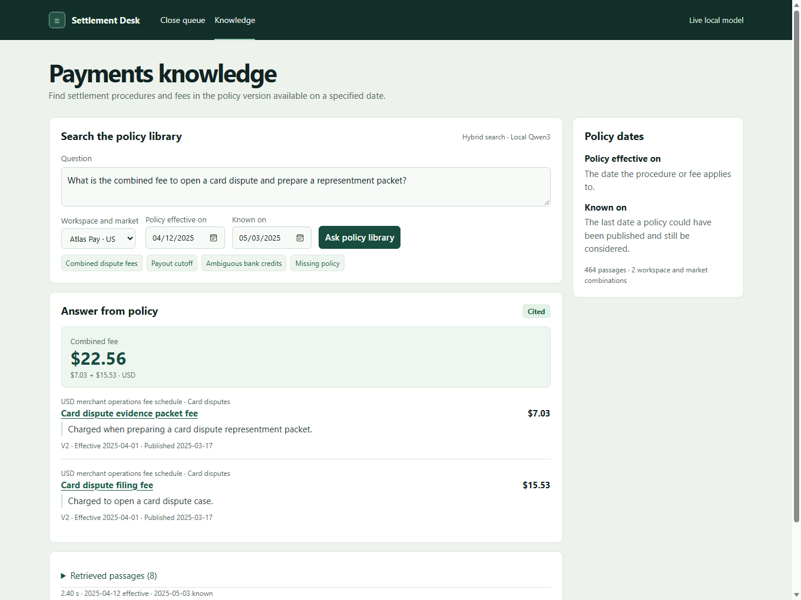

# Settlement Desk

Settlement Desk — система для расследования расхождений в выплатах между учётным реестром продавца, отчётами платёжного процессора и банковской выпиской. Система проверяет выводы модели по первичным данным, оставляет неоднозначные зачисления открытыми для дальнейшего расследования и сохраняет решения аналитика при повторном импорте исправленных данных.

[Четырёхминутная демонстрация](assets/settlement-desk-walkthrough.mp4) · [Case Study](docs/case-study.md) · [Структурированный бенчмарк](results/benchmarks/benchmark-v2.json) · [Бенчмарк анализа переписки](results/benchmarks/support-benchmark.json) · [Спецификация импорта](docs/inputs.md)

**Payments knowledge** отвечает на вопросы об операционных процедурах и комиссиях, используя версию регламента, применимую к выбранному workspace, рынку и дате. Система запускает Qwen локально, связывает утверждения с соответствующими фрагментами документов и рассчитывает совокупные комиссии на основе исходных тарифных строк, используя целочисленные значения в центах.

[Case Study по Knowledge RAG](docs/knowledge-rag.md) · [Результаты бенчмарка](results/benchmarks/knowledge-benchmark.json)


## Запуск демонстрации

Запускайте команды из корневой директории проекта. Требуется Python 3.11 или новее.

```powershell
python run.py demo
```

Откройте [очередь сверки](http://127.0.0.1:8765).

Демонстрация работает локально с использованием сохранённых ответов модели. Для выплаты с расхождением в реестре на $150 нажмите **Run investigation**. Перейдите по ссылке на первичный источник, подтвердите предложенное объяснение и вернитесь к очереди.

Затем откройте выплату с необъяснённым расхождением в банковских данных и запросите недостающий идентификатор банковской операции.

Во втором терминале импортируйте два пакета исправленных исходных данных. Обновите страницу очереди, чтобы увидеть, что оба случая теперь успешно сверяются. Для каждого случая сохраняются ссылки на ранее полученные доказательства и решение аналитика.

```powershell
python run.py import artifacts/workbench/desk-sample-inputs/03-corrected-ledger/manifest.json artifacts/workbench/desk-sample-inputs/04-bank-trace/manifest.json
```

Для повторения исходного сценария запустите демонстрацию с новым путём к базе данных через `--db`.

Для запуска детерминированного rule-based baseline используйте `--mode baseline`.

## Запуск с локальной GPU

```powershell
pwsh -File scripts/with-model.ps1 -Task demo-live
```

Windows-скрипт запускает закреплённую версию Ollama и checkpoint Qwen3 8B Q4_K_M из локального кэша проекта.

Первоначальная загрузка составляет около 7 ГБ. Для кэширования и распаковки рекомендуется выделить 15 GiB свободного дискового пространства.

Live-демонстрация использует отдельную базу данных и выводит пути к файлам исправлений.

Для завершения демонстрации и остановки запущенного модельного сервиса нажмите `Ctrl+C` в терминале.

## Анализ переписки с поддержкой

Два банковских зачисления могут иметь одинаковую сумму, тогда как структурированный идентификатор операции от платёжного процессора отсутствует.

Дополнительная переписка с поддержкой процессора может помочь различить эти операции благодаря исправлениям, ответам на предыдущие сообщения или упоминаниям другого продавца.

Локальная LLM извлекает предполагаемую операцию и проверяет интерпретацию по содержимому переписки. Программная логика проверяет соответствующее банковское зачисление и сохраняет точные цитаты из источника.

При этом расследование остаётся открытым до получения структурированного идентификатора и дальнейшей проверки аналитиком.

```powershell
pwsh -File scripts/with-model.ps1 -Task demo-support
pwsh -File scripts/with-model.ps1 -Task benchmark-support
python run.py support-fixtures
```

Команды необходимо выполнять по отдельности.

Первая команда запускает демонстрацию анализа переписки. В новой демонстрационной базе данных [case 1](http://127.0.0.1:8765/cases/1) показывает зачисление, проведённое ночью, и отменённую пакетную операцию восстановления.

Нажмите **Run investigation**, чтобы просмотреть цитаты из источников и предложенный идентификатор операции.

Бенчмарк оценивает оба режима работы по независимо заданной эталонной разметке идентификаторов операций и цитат.

Команда `support-fixtures` экспортирует пакеты исходных данных, пригодные для последующего импорта.

## Работа с библиотекой платёжных регламентов

```powershell
pwsh -File scripts/with-model.ps1 -Task demo-rag
```

Откройте [Payments knowledge](http://127.0.0.1:8765), выберите **Combined dispute fees** и отправьте запрос.

Для Atlas Pay · US при регламенте, действующем на 12 апреля 2025 года и известном системе на 3 мая 2025 года, сумма двух комиссий из цитируемых тарифных строк составляет **$22.56**.

Измените параметр **Known on** на 25 мая 2025 года и отправьте запрос повторно, чтобы увидеть ретроактивную корректировку и новую сумму **$23.62**.

Откройте любую цитату, чтобы проверить точный фрагмент документа, даты и digest документа.



Демонстрация Knowledge RAG дополнительно загружает закреплённый checkpoint Qwen3 Embedding размером 639 MB в локальный кэш.

Команда `python run.py demo` также предоставляет доступ к этой библиотеке, используя офлайн-поиск по ключевым словам.

Для использования собственной версионируемой синтетической библиотеки передайте `-KnowledgeCorpus <path>` в live-скрипт или `--knowledge-corpus <path>` при запуске `python run.py serve`.

[Спецификация импорта JSONL](docs/policy-library.md)

## Импорт других синтетических данных

Используйте [спецификацию CSV и manifest](docs/inputs.md), чтобы создать отдельный пакет данных для каждого снимка состояния выплат.

Для новой процедуры сверки используйте отдельную локальную базу данных.

```powershell
python run.py import some-folder/manifest.json --db artifacts/my-close.db
python run.py list --db artifacts/my-close.db
python run.py serve --db artifacts/my-close.db
```

По умолчанию команда `serve` запускает режим, использующий только детерминированные правила.

Если закреплённый модельный сервис уже работает на порту `11439`, команда `serve --mode live` позволяет использовать LLM.

Сервер принимает соединения только через loopback и предназначен для работы одного аналитика с синтетическими данными.

## Проверка релиза

```powershell
python run.py check
python -m unittest discover -s tests
pwsh -File scripts/with-model.ps1 -Task benchmark
pwsh -File scripts/with-model.ps1 -Task benchmark-support
pwsh -File scripts/with-model.ps1 -Task benchmark-rag
pwsh -File scripts/with-model.ps1 -Task release
python run.py package
```

Бенчмарк сопоставляет каждый зафиксированный набор входных данных с результатами rule-based baseline и live-модели.

Система поддерживает возобновление выполнения с checkpoints при совпадении контрольных digest модели, данных и реализации.

Команда `release` дополнительно проверяет доступность GPU, валидирует сохранённые результаты бенчмарков и запускает демонстрацию из чистой временной копии исходного кода.

Команда `package` создаёт архив `artifacts/Settlement-Desk.zip`, включающий исходный код, данные для воспроизведения, демонстрационное видео и материалы проверки релиза.

Закреплённая среда выполнения модели и исходные локальные результаты запусков хранятся в `.runtime/` и `artifacts/`.

Демонстрационное видео создано на основе записей Microsoft Edge в desktop- и mobile-режимах.

Для повторной генерации видео выполните:

```powershell
python run.py walkthrough
```

Для этого необходимы Microsoft Edge, Node.js версии 22 или новее и FFmpeg.

В Windows рендерер также может использовать wheel-пакет `imageio-ffmpeg 0.6.0`, закреплённый по SHA-256 и размещённый по пути `.runtime/ffmpeg-wheel.whl`.

[Закреплённый Windows wheel](https://pypi.org/project/imageio-ffmpeg/0.6.0/#imageio_ffmpeg-0.6.0-py3-none-win_amd64.whl)

## Структура репозитория

- `settlement/` — движок сверки, AI-интеграция, хранение данных и web UI.
- `evaluation/` — датасеты, средства оценки, синтетические сценарии и скрипты запуска бенчмарков.
- `scripts/` — запуск моделей, демонстрационные сценарии и утилиты подготовки релиза.
- `config/` — закреплённые конфигурации моделей.
- `results/` — опубликованные отчёты бенчмарков и сохранённые ответы моделей для демонстраций.
- `assets/` — скриншоты и демонстрационное видео.
- `docs/` — case studies, спецификации входных данных и [происхождение результатов бенчмарков](docs/benchmark-provenance.md).
- `tests/` — автоматизированные тесты.

Контрольные отпечатки опубликованных бенчмарков соответствуют историческим версиям исходного кода. Подробности приведены в [документации о происхождении результатов](docs/benchmark-provenance.md).
