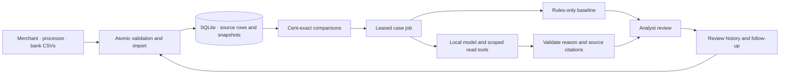

# Settlement Desk case study

## The close problem

A merchant expects a $10,000 payout. The processor settles $9,850 and the bank posts $9,850. An analyst needs to determine which source explains the discrepancy and retain enough evidence for a second person to reproduce the conclusion. Settlement Desk presents each comparison in cents, runs a local investigation, and turns a verified finding into a reviewable work item.

The $150 difference comes from a processor refund that appears in the merchant's refund receipts but is absent from its ledger. The investigation cites the refund, original charge and receipt. The analyst records an explanation, and a new ledger snapshot settles the case. A separate case shows two same-amount bank credits without a unique trace. The system requests the trace and retains the candidate IDs until the corrected statement arrives. [Four-minute walkthrough](../assets/settlement-desk-walkthrough.mp4)

## Design

The feature I would trust first is deterministic reconciliation. A unique trace is required for a bank match. Offsetting line errors remain visible even when the aggregate variance is zero. A review is tied to a snapshot and can become stale when a new file changes the relevant evidence. The model receives a bounded set of read-only tools. It proposes a reason and observed source IDs. Deterministic rules check the proposal and supply the financial fields. A timeout, invalid citation, or repeated rejected proposal leaves the case open.

The single-user app uses Python's standard library, SQLite WAL and a loopback HTTP server. It preserves rejected model proposals, leased worker attempts, source digests, and versioned reviewer decisions. Synthetic event generation supplies the benchmark answer key. The application and model work only from the exported observations. [Input contract](../docs/inputs.md) · [Local quickstart](../README.md)

## Benchmark design

The frozen second holdout contains 132 unique payout snapshots with injected refunds, erroneous fees, bank amount differences, offsetting line errors, clean cases, late feeds and ambiguous credits. It includes overlapping bank and ledger problems. The benchmark runs the rules-only baseline and live model against each snapshot. A correct result requires the expected reason, signed amount, comparison and exact evidence IDs. The first 12 cases run three times to measure repeatability. Clean results bypass inference and are scored separately. [Frozen manifest](../results/benchmarks/evaluation-v2-manifest.json) · [Per-case results](../results/benchmarks/benchmark-v2-cases.json)

The first holdout exposed a systematic tool interface failure. The baseline scored 132/132 and the model produced no correct exception diagnosis. The tool runner expected empty arguments while the model supplied case and cutoff. Subsequent development runs also produced wrong reasons and incomplete citations. The revised interface explicitly declares scoped arguments, routes the investigation to the unresolved comparison, constrains the model's JSON output to observed IDs, and bounds repairs. The second holdout uses a different seed and was frozen before the revised release run. [Initial run](../results/benchmarks/benchmark.json)

## Results on the RTX 5060 Ti

| Held-out outcome | Live model with verifier | Rules-only baseline |
| --- | ---: | ---: |
| Resolvable exceptions diagnosed with exact evidence | 66/66 | 66/66 |
| Underdetermined cases with the expected evidence request or recheck | 48/48 | 48/48 |
| Clean cases reconciled | 18/18 | 18/18 |

The model produced zero false resolutions across 48 underdetermined cases. All 24 additional repeat runs matched their expected output. Live exception investigations took 1.96 seconds at the median and 2.58 seconds at the 95th percentile after the readiness probe warmed the model. Ollama reported 5.20 GiB of GPU-resident model data. Peak sampled device usage was 6,433 MiB, including other allocations on the card. Paid API charges were $0. The scripted browser workflow completed two reviewer actions and two follow-up resolutions in 12.12 seconds, including browser startup. [Benchmark summary](../results/benchmarks/benchmark-v2.json) · [Browser walkthrough receipt](../assets/walkthrough.json)

The model tied the baseline on structured evidence. The rules processed those fixed cases faster. When a structured trace is missing, a processor support thread can supply a lead that requires interpreting corrections and references across messages.

## Where the model improves coverage

The support-note benchmark gives both systems the same bank credits and timestamped processor thread. The regex baseline recognizes explicitly confirmed references and abstains when several candidate traces appear. The model extracts the reference, cites the notes that establish it, and checks the proposal in a second model pass. Deterministic checks bind the proposal to a unique equal-amount credit and the original messages. The analyst requests a structured processor reference before reconciliation.

| Held-out support threads | Regex and rules | Local model |
| --- | ---: | ---: |
| Correct trace with evidence | 2/8 | 6/8 |
| Correct abstentions when evidence was insufficient | 3/3 | 3/3 |
| Incorrect proposals | 0 | 0 |
| Median time per case | 23 ms | 2.93 s |

The model found four traces the baseline missed. It followed an overnight posting after a recovery batch was cancelled, used the bank's credit screen instead of an internal ticket number, resolved “the former” in a later reply, and distinguished a merchant disbursement from a prefunding move. It withheld proposals on two resolvable threads, including a correction about which day's file actually posted. Earlier development runs exposed premature proposals on inconclusive notes. The separate evidence check addressed those failures before the held-out evaluation. The measured difference applies to these 11 synthetic threads. [Per-case traces, citations, and results](../results/benchmarks/support-benchmark.json)

## Résumé bullet

> Local AI workbench for three-way payout reconciliation with auditable evidence and analyst review. On held-out synthetic support threads, the LLM recovered 6/8 correct bank traces versus 2/8 for regex and rules, with zero incorrect proposals. The structured workflow matched rules on 132 held-out payouts.

## Limitations

The evaluation covers synthetic scenarios and a simulated browser workflow. The structured baseline and verifier share a rulebook. The support-note comparison covers 11 held-out English-language threads and one conservative regex baseline. Real analyst handling time, provider coverage, and production accuracy require separate evaluation.
