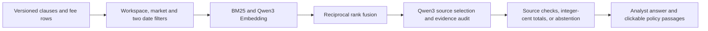

# Settlement Desk · Payments knowledge

A payments analyst investigating a historical payout needs the procedure and fee schedule that applied at the time, including any corrections the analyst could have known about. The knowledge desk answers from a versioned library, links each result to its source passage, and combines fee amounts with integer arithmetic. It runs on the same loopback workbench as the payout investigation and review queue.

## Measured results

The frozen holdout contains 98 scenarios covering 67 distinct questions, including 28 policy-revision retests and four queries before any policy was published. The indexed corpus contains 4,176 versioned passages across 18 workspace and market combinations, with 67 distinct embedding inputs after reuse.

| Metric | Scoped BM25 | Scoped dense | Scoped hybrid |
| --- | ---: | ---: | ---: |
| All required evidence in the top eight | 73/80 | 80/80 | 80/80 |
| Required passage recall at eight | 98/105 | 105/105 | 105/105 |
| Correct answer and exact citations | | 78/80 | 76/80 |
| Correct abstention | | 12/18 | 12/18 |
| Exact fee total and operands | | 21/21 | 21/21 |
| Overall end-to-end correctness | | 90/98 | 88/98 |
| Out-of-scope passages retrieved | 0 | 0 | 0 |

Hybrid ran at **0.83 s median and 0.98 s p95** on an RTX 5060 Ti after warm-up, including retrieval, both model passes when needed, and deterministic verification. The three retrieval rankings took 54 ms median. Both model-backed modes cited zero out-of-scope passages and calculated every labeled fee total exactly. [Reproducible benchmark receipt](../results/benchmarks/knowledge-benchmark.json)

Dense and hybrid both found all required evidence. Dense scored two more end-to-end cases. Hybrid missed a requested part or selected an extra citation on four answerable scenarios. Each mode answered six questions that should have been declined. One false answer cited a domestic ACH fee for a request about a missing return file.

## Résumé bullet

> Built a local payments RAG system with point-in-time policy retrieval and auditable citations. Retrieved complete evidence for 80/80 answerable scenarios at top eight versus 73/80 for BM25, calculated 21/21 fee totals exactly, and served responses at 0.98 s p95 on 98 synthetic scenarios.

## How it works



The importer validates whole policy editions and persists embeddings by checkpoint and search-text digest. A request chooses a workspace, market, effective date and publication cutoff. Retrieval ranks only the latest eligible edition of each document. The generator receives a bounded list of clauses and typed fee rows. It selects source numbers, then rechecks coverage in a second pass. The application validates the numbers against the retrieved passages and the active scope. It renders exact source text and sums selected fee rows in code. A stable passage ID and SHA-256 link each citation to its edition.

The retrieval design draws on the multistage lexical and neural ranking used in the TREC 2025 RAG track. The evaluation checks required passages and exact citations because finding a relevant financial document can still leave the answer unsupported. Fee rows keep their labels and numeric types, following the mixed text-and-table evaluation used in financial RAG research. [TREC 2025 RAG system paper](https://trec.nist.gov/pubs/trec34/papers/cfdalab.rag.pdf) · [Financial RAG retrieval failure analysis](https://arxiv.org/abs/2602.17981) · [T²-RAGBench](https://www.edit.fis.uni-hamburg.de/ws/files/63055447/2506.12071v1.pdf) · [Qwen3 Embedding technical report](https://arxiv.org/abs/2506.05176)

## Reproduce

```powershell
pwsh -File scripts/with-model.ps1 -Task benchmark-rag
pwsh -File scripts/with-model.ps1 -Task demo-rag
```

Run these commands separately. The benchmark validates the frozen question and corpus hashes, saves full predictions and timings under `artifacts/`, and publishes a compact receipt. The demo starts the local workbench. Select **Knowledge** and **Combined dispute fees**. The two fee rows total $22.56 under the published April edition and $23.62 once the May correction is visible. [Frozen evaluation manifest](../results/benchmarks/knowledge-eval-manifest.json) · [Selected benchmark results and examples](../results/benchmarks/knowledge-benchmark.json) · [Policy library import](../docs/policy-library.md)

## Evaluation design

Retrieval compares BM25, dense retrieval and reciprocal rank fusion with the same corpus, date filters and eight-passage budget. Dense and hybrid end-to-end runs share the same pinned Qwen3 8B Q4_K_M checkpoint, citation audit and verifier. A correct answer selects the entire expected passage set without extra citations. Combined-fee questions also require an exact cents total. Missing evidence requires abstention. The evaluator derives allowed editions independently from the frozen scopes and checks every exposed candidate and citation. The application receives questions and scope parameters while labels stay in the evaluator.

The benchmark uses synthetic policy editions and hand-authored questions. Many editions share text while changing dates or amounts, so scenario counts include deliberate retests of the same question at different dates. The local deployment has a single operator, selectable workspace filters, and USD-denominated fees. The benchmark measures exact evidence selection on this corpus. Public FinanceBench performance, authenticated multi-tenant isolation and handling time for a real payops team are outside the measured scope. [FinanceBench methodology](https://arxiv.org/abs/2311.11944)
